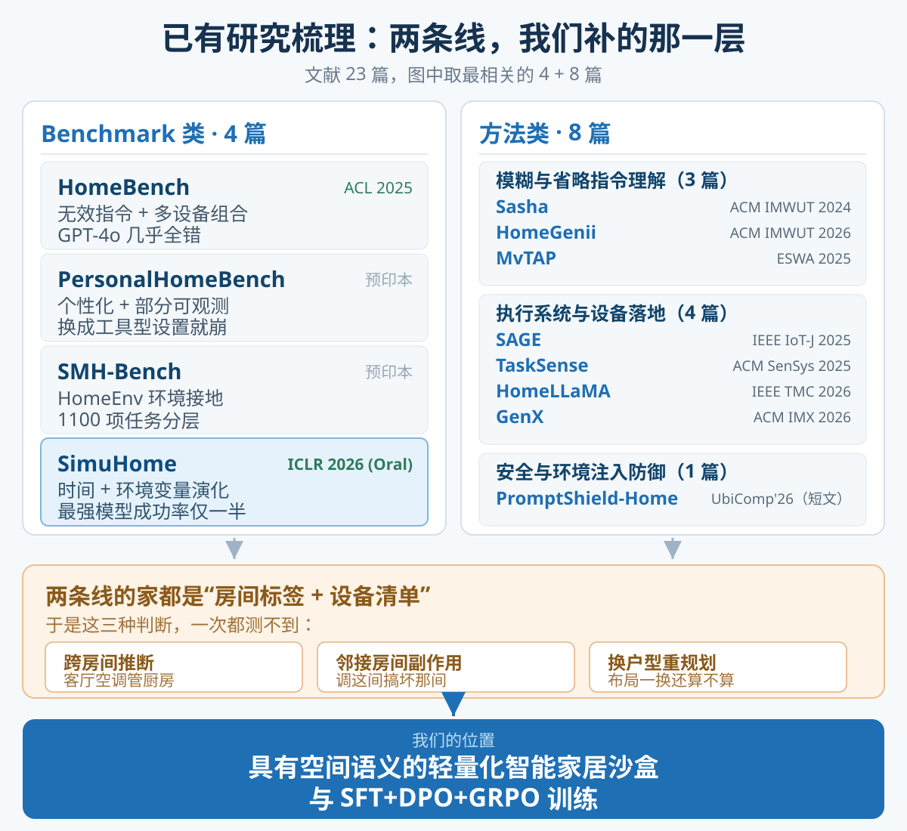
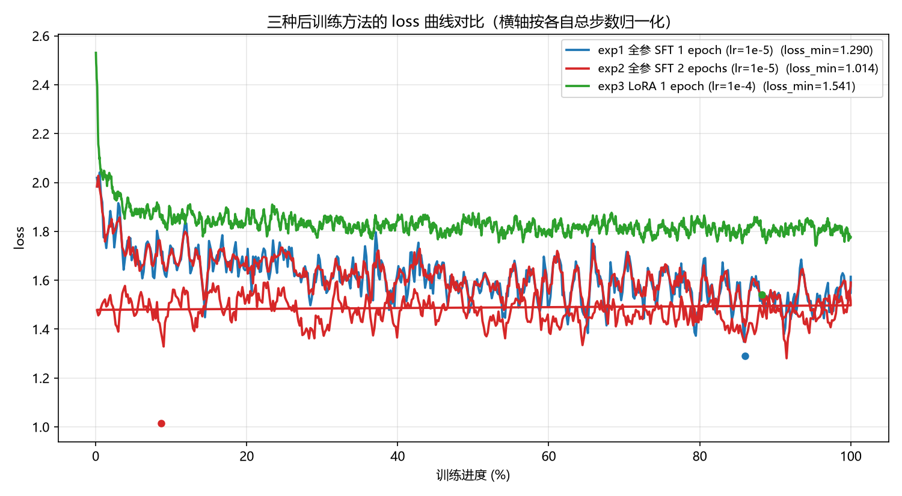
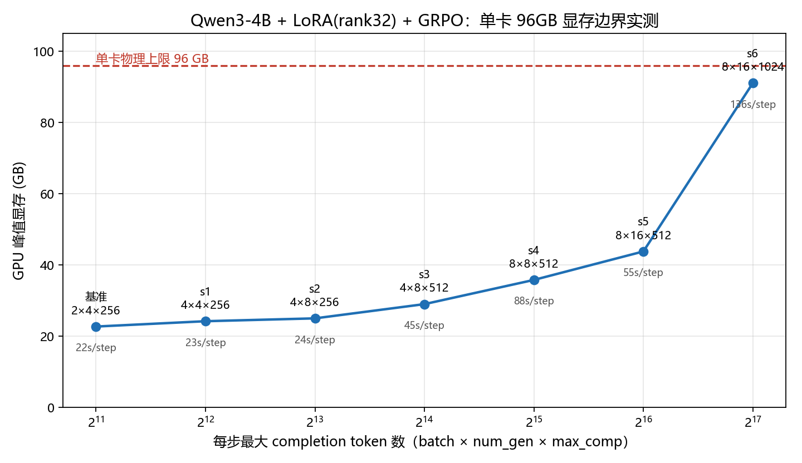
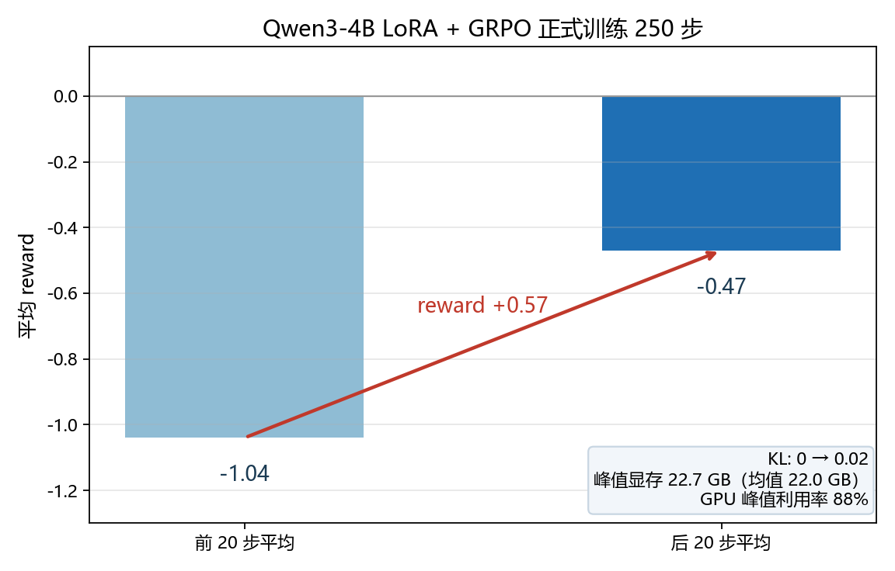

# 方向汇报：具有空间语义的轻量化智能家居沙盒与 SFT+DPO+GRPO 训练

汇报人：靳明朴

## 0. 领域已经做到哪一步，我们往前推什么

智能家居智能体的单点能力已经被解决得差不多了：无效指令、多设备组合有成熟基准，模糊与省略指令有一批 ubicomp 工作，执行侧出现了能真正驱动设备的代理系统，个性化与长期记忆也有人接手。这些工作共享一种表示方式——家是一组房间标签，设备挂在标签下面。房间之间连不连通、热量和气流往哪边走，从来不进入状态，也不参与决策。

我们打算把空间关系补成真正参与推理的一层：房间是节点，连通关系是边，环境变量沿边演化。“客厅空调能不能管到厨房”“调这间会不会把邻居搞坏”“换个户型方案还成不成立”，由此变成可以查、可以算、可以验证的问题。承载它的沙盒刻意做轻，只保留让这些因果关系成立的最小机制，不搬物理引擎进来。在这个基础上做 SFT → DPO → GRPO 三级训练，最后在真实设备上做一次小规模迁移验证。

论文暂定方向：

```text
具有空间语义的轻量化智能家居沙盒与 SFT+DPO+GRPO 训练
A Lightweight Smart-Home Sandbox with Spatial Semantics for SFT+DPO+GRPO Training
```

## 1. 为什么选这个方向

起点是一个真实家庭里很常见、但现有基准测不出来的例子：

```text
用户要求：20 分钟内让厨房达到舒适温度
环境条件：厨房没有空调；客厅有空调；客厅与厨房连通

正确做法   用客厅空调 + 连通关系，等环境变化，最后验证厨房温度是否达标
错误做法   回答“厨房没有空调”（漏掉可行解），或虚构一台厨房空调（幻觉执行）
```

决定成败的不是“会不会调空调”，而是“知不知道两个房间连通、冷气会往哪边跑、十分钟后要回头验证”。现有工作对家庭的表示基本都停在“房间名 + 房间内设备清单”，房间之间没有边，于是三类真实能力测不出来：

```text
跨房间推断        客厅空调能不能影响厨房
副作用控制        调一个房间会不会把邻接房间搞坏
换一种户型后重规划  房间连通关系变了，原方案是否还成立
```

对应的评测设计是整篇论文最关键的一点：固定同一批设备和同一条指令，只改房间之间的连通关系，正确答案就从“用客厅空调”变成“不可行、需要替代方案”。模型必须真的用上拓扑，背固定布局背不出来。

## 2. 已有工作做了什么、发在哪里



下表是本方向最相关的工作。

| 论文              | 做了什么                                                                                                                                                                                        | 发表出处                                                                |
| ----------------- | ----------------------------------------------------------------------------------------------------------------------------------------------------------------------------------------------- | ----------------------------------------------------------------------- |
| HomeBench         | 大规模显式与无效指令评测，100 个场景、17 万条指令；GPT-4o 在多设备无效指令上几乎全错                                                                                                            | ACL 2025（DOI 10.18653/v1/2025.acl-long.597）                           |
| SAGE              | 把用户请求变成 LLM 控制的动作序列：选工具、读设备 API、写监控条件、按设备照片消歧；自建 50 项任务，GPT-4 下成功率 75%，两个基线约 30%（期刊版题名为 AIoT Smart Home via Autonomous LLM Agents） | IEEE Internet of Things Journal 2025（DOI 10.1109/JIOT.2024.3471904）   |
| Sasha             | 把“让客厅舒适”这类欠明确目标推理成设备动作，含用户调研与真实家庭部署                                                                                                                          | ACM IMWUT 2024（DOI 10.1145/3643505）                                   |
| HomeGenii         | 检索增强生成增强型 TAP 规则，规则生成准确率从 14% 提到约 84%                                                                                                                                    | ACM IMWUT 2026（DOI 10.1145/3789673）                                   |
| TaskSense         | 把异构传感器能力翻译成 LLM 能用的“传感器语言”，真实家居部署，规划准确率最高 2×                                                                                                               | ACM SenSys 2025（DOI 10.1145/3715014.3722070）                          |
| MvTAP             | 从触发器—动作规则预测隐性意图（节能、安全等），IFTTT 5 万条规则                                                                                                                                | Expert Systems with Applications 2025（DOI 10.1016/j.eswa.2024.126198） |
| HomeLLaMA         | 定制本地小模型做隐私保护 + 个性化，敏感请求留在设备端                                                                                                                                           | IEEE TMC 2026（DOI 10.1109/tmc.2026.3654976）                           |
| GenX              | 多模态生成式体验的设备编排，感知—生成—执行整链打通                                                                                                                                            | ACM IMX 2026（DOI 10.1145/3788851.3805008）                             |
| PromptShield-Home | 环境多模态提示注入防御，改报不安全执行率与安全完成率                                                                                                                                            | ACM UbiComp Companion 2026 短文（DOI 10.1145/3798063.3837198）          |

按研究问题归成三条线，缺口就在三条线的交集之外：

```text
听懂用户     把省略、隐式、规则文本补成明确动作（Sasha、HomeGenii、MvTAP）
             下游是单房间、单设备，不涉及房间之间的相互影响

执行与落地   设备动作序列落地、传感器调度、隐私个性化、多模态编排
             （SAGE、TaskSense、HomeLLaMA、GenX）
             空间只当静态标签用，“在哪个房间”只服务定位，不参与推理

评测         把无效指令与注入风险做成量化口径（HomeBench、PromptShield-Home）
             评测单元仍是“指令—设备”，没有拓扑维度的对照设计
```

两点说明：发表栏里有两处更正——HomeBench 本地标注是 CHI 2024，实际为 ACL 2025 长文；Sasha 本地标注是 CCS 2024，实际为 IMWUT 2024。其余相关工作（含训练数据飞轮方向）已整理进文献总结，这里不逐条展开。

## 3. 我们的创新点

```text
一 空间语义做成可操作对象，而不是 prompt 里的一个字段
   环境侧：房间节点 + 连通边 + 设备锚点，环境变量沿连通边传播
   模型侧：查拓扑 → 预测影响范围 → 选方案 → 等待后验证
   验证侧：目标达成、副作用违规、拓扑变化后是否重规划，全部由环境状态判定

二 沙盒做得轻，但空间因果关系算得清
   只保留四样东西：房间图、设备状态机、每房间温度/湿度/光照的轻量差分演化、
   统一虚拟时钟（tick / 快进 / 事件调度），外加快照、回放与固定随机种子
   明确不做：三维物理、精确导航、自动替模型编排完整方案
   这样做的理由：空间因果关系要可计算、可验证、可复现，不需要把物理引擎搬进来

三 对照设计保证拓扑真的改变答案
   同设备集合 + 同指令 + 只改连通关系，让正确方案发生翻转；
   另设训练中未出现过的拓扑做泛化测试，防止记布局

四 三级训练各有明确监督信号
   SFT   学标准流程：观察 → 查空间/设备 → 执行 → 等待 → 验证
   DPO   学“多个可行解里选更合适的”：偏好对由环境验证结果生成，不用额外训练奖励模型
   GRPO  学多步之后才看得出好坏的目标：奖励直接读环境状态与目标条件，组内相对比较
```

与已有工作的差别：

```text
对 HomeBench        它在“指令—设备”维度做得很满，我们补的是房间之间的拓扑维度
对 SAGE            它是工具序列驱动的执行代理，设备在哪个房间是查出来的静态属性，
                   房间之间的相互影响不在它的决策范围
对 Sasha / HomeGenii 它们把模糊话补成明确动作，我们要求补完之后判断跨房间是否可行
对以上全部          它们评测“做完对不对”，我们额外评测“有没有把邻居房间搞坏”
```

## 4. 我已经做了哪些准备

### 4.1 文献整理

4 篇智能家居 benchmark 逐篇总结 + 三类对比，19 篇方法论文逐篇总结 + 按研究问题分类（安全 3、模糊指令 6、综合方案 8、补充 2），每篇都带数据集、基线、指标和关键数字。上面第 2 节那张表和“空间连通无人覆盖”的结论就是从这轮整理里出来的。

### 4.2 后训练链路验证（MiniMind 63.91M，AutoDL RTX 5090 32GB）

目的不是刷指标，是把“从预训练底座出发做后训练、再探针评测”的整条链路跑通，确认数据结构、模板、loss 计算、评测脚本这些环节都对。

```text
模型   MiniMind minimind-3（Dense），63.91M 参数，d_model 768，8 层，词表 6400
数据   sft_t2t_mini，905,718 条对话，label 只算 assistant 部分

exp1   全参 SFT 1 epoch   loss 最低 1.29
exp2   全参 SFT 2 epoch   loss 最低 1.014
exp3   LoRA 1 epoch       可训练参数 0.797M（全参的 1/80），loss 最低 1.541
```



结论：同一份数据多训一轮仍然有效；同预算下全参优于 LoRA，但 LoRA 用 1/80 的参数拿到接近效果；loss 下降不等于回答变好，SFT 最明显的作用是学会按指令格式回答，事实性错误仍在，这部分留给后面的偏好与强化阶段。

### 4.3 GRPO 单卡可行性（Qwen3-4B + LoRA，AutoDL RTX PRO 6000 96GB）

后面的训练要在一张 96GB 卡上跑，所以先测清楚 batch、group size、生成长度能把显存推到哪。

| 配置         | batch × num_gen × max_comp | 峰值显存 |   步时 |
| ------------ | ---------------------------- | -------: | -----: |
| 正式训练基准 | 2 × 4 × 256                |  22.7 GB |  ~22 s |
| s2           | 4 × 8 × 256                |  25.0 GB |  ~24 s |
| s3           | 4 × 8 × 512                |  29.0 GB |  ~45 s |
| s4           | 8 × 8 × 512                |  35.8 GB |  ~88 s |
| s5           | 8 × 16 × 512               |  43.8 GB |  ~55 s |
| s6           | 8 × 16 × 1024              |  91.1 GB | ~136 s |



```text
实测边界      8 × 16 × 1024，峰值 91.1GB，余量只有约 5GB，只能当参考，不能长期跑
推荐区间      4~8 × 8 × 512，峰值 29~36GB，只占三分之一显存，留足冗余
最敏感的一维  completion 长度：max_comp 从 512 提到 1024，峰值显存从 43.8GB 翻到 91.1GB
```

在这个基础上，用 `batch=2 × num_gen=4 × max_comp=256` 跑通了 250 步正式训练：reward 从前 20 步的 -1.04 升到后 20 步的 -0.47，KL 从 0 涨到约 0.02，峰值显存 22.7GB，GPU 峰值利用率 88%。



### 4.4 这些准备说明什么

```text
已验证   完整后训练链路走通过一遍；单卡 96GB 上 Qwen3-4B + LoRA 的 GRPO 可稳定训练，
         且已知道显存随规模变化的量级和推荐配置
据此推断  后面在这个沙盒上做三级训练，算力不是瓶颈，瓶颈在沙盒与任务数据的质量
待确认   当前 GRPO 用的是通用奖励模型与通用任务，还没接环境可验证奖励；
         DPO 的偏好对生成 pipeline 还没有；
         空间传播取“纯连通图”还是“连通图 + 轻量差分”，会直接决定任务难度分布
```

## 5. 下一步工作顺序

```text
固定房间、连通边、设备状态、环境传播的最小数据结构
        ↓
实现轻量化沙盒内核：可快进、可重置、可验证，先跑无头模式
        ↓
生成首批任务与 SFT 示范轨迹，接通环境可验证奖励
        ↓
完成 直接提示 / SFT / SFT+DPO / SFT+DPO+GRPO 四档基线与消融
        ↓
未见拓扑泛化测试，再做真实家庭小规模零样本验
```
