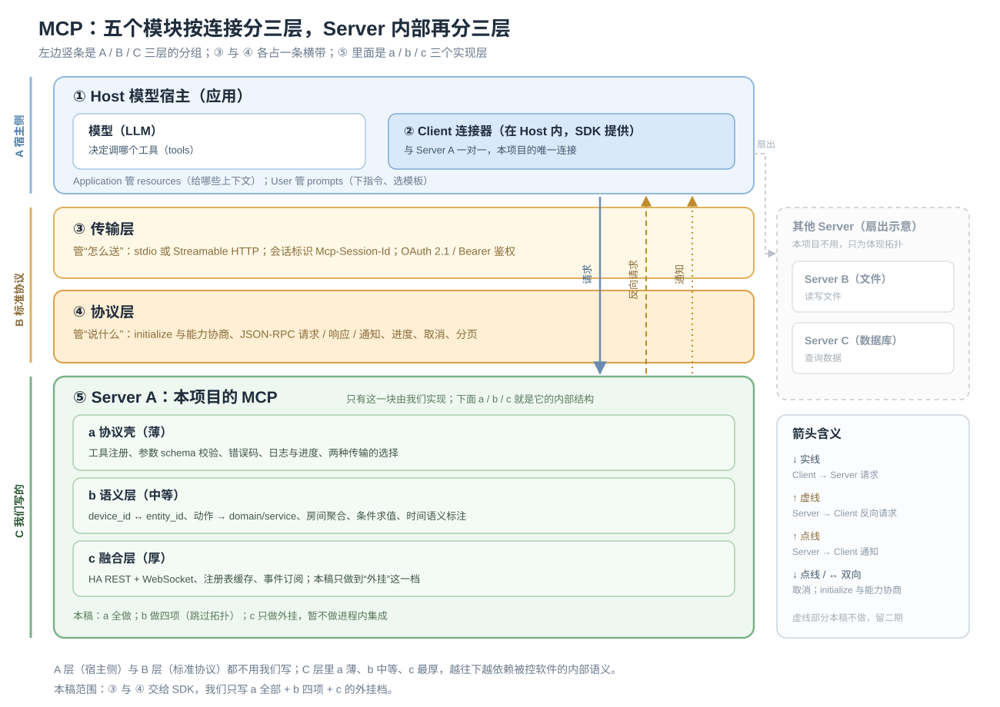

# MCP 架构通用性说明

> 过程稿：分层与通用性论证保留作参考，实现规格以 `11_最终设计_接入层与统一语义MCP.md` 为准。

回答两件事：05 文档里那套设计是不是通用架构；从 MCP 的常见模块看，一共有哪几个核心部分。
下面所有协议能力都对着本机 HA 容器里装的那份 SDK（`mcp` 1.26.0）核过，不是凭记忆写的。

## 1. 结论先给

```text
协议层    通用。我们与标准 MCP 的分层一一对应，没有自创协议
骨架层    通用。传输、会话、能力注册、错误约定、日志，这套骨架换任何后端都不变
能力选择  tools-only。这是 MCP 服务端最常见的形态，客户端兼容性最好
业务层    不通用。ha\ 目录下的适配、动作映射、目标断言、时间语义都是本项目专用

准确说法：协议与骨架通用，领域层专用；换后端时替换 ha\ 与少量工具实现即可
```

## 2. 标准 MCP 的五个核心部分



同一张图有两个维度，看的时候别混：

```text
按连接分三层（图左侧的竖条）
  A 宿主侧    ① Host 与 ② Client，不用我们写
  B 标准协议  ③ 传输层与 ④ 协议层，各占一条横带，由标准与 SDK 提供
  C 我们写的  ⑤ Server，只有这一块是我们的

Server 内部再分三层（⑤ 里的 a / b / c）
  a 协议壳（薄）    工具注册、参数 schema 校验、错误码、日志与进度
  b 语义层（中等）  device_id ↔ entity_id、动作映射、房间聚合、条件求值、时间语义
  c 融合层（厚）    HA REST 与 WebSocket、注册表缓存、事件订阅
```

③ 与 ④ 的区别在图上直接写出来了：③ 管“怎么送”（stdio 或 Streamable HTTP、会话标识、鉴权），④ 管“说什么”（initialize 与能力协商、JSON-RPC 的请求响应通知、进度、取消、分页）。

本稿范围：a 全做，b 做四项（跳过拓扑），c 只做“外挂”这一档；虚线代表的取消、反向请求与资源留给二期。Server B、C 画在右上边缘，只是用来体现扇出，本项目不用。

源文件是同目录的 `06_MCP五层架构图.svg`，另有一份位图 `06_MCP五层架构图.png`，给不支持 SVG 渲染的阅读器用。

```text
① Host      模型宿主：Claude Desktop、自研 agent、我们的评测脚本
             负责持有模型、发起对话、创建 client

② Client    连接器：与某个 server 一对一连接，管会话与请求配对
             由 SDK 提供，我们不用自己写

③ 传输层    stdio（本地子进程）或 Streamable HTTP（POST /mcp，无状态或带会话）
             HTTP 走 OAuth 2.1；标准里还有 RFC 9728 保护资源元数据

④ 协议层    initialize 握手 → 能力协商 → 请求 / 响应 / 通知 → 关闭
             含 ping、进度通知、日志通知、取消、分页

⑤ Server    我们要写的东西，分两块
             能力层（primitive）：对客户端暴露什么
             业务层：怎么把请求落到真实后端（协议不管这一层）
```

## 3. 服务端能力清单（SDK 实测）

本机容器里的 SDK 暴露了这些请求类型：`InitializeRequest`、`PingRequest`、`ListToolsRequest`、`CallToolRequest`、`ListResourcesRequest`、`ListResourceTemplatesRequest`、`ReadResourceRequest`、`SubscribeRequest`、`UnsubscribeRequest`、`ListPromptsRequest`、`GetPromptRequest`、`CompleteRequest`、`SetLevelRequest`、`CreateMessageRequest`、`ListRootsRequest`、`ElicitRequest`，以及一组任务类请求（`GetTaskRequest`、`ListTasksRequest`、`CancelTaskRequest`、`GetTaskPayloadRequest`）。

| 能力 | 方向 | 谁控制 | 语义 | 本稿用不用 |
| --- | --- | --- | --- | --- |
| `tools/list`、`tools/call` | 服务端提供 | 模型 | 可执行函数，MCP 的主力 | 用，8 个工具 |
| `resources/list`、`read`、`subscribe` | 服务端提供 | 应用 | 上下文数据（文件、快照） | 不用，留作升级点 |
| `prompts/list`、`get` | 服务端提供 | 用户 | 提示模板 | 不用，留作升级点 |
| `logging`（`setLoggingLevel` + 日志通知） | 双向 | 服务端 | 结构化日志推给客户端 | 计划用 |
| 进度通知、取消 | 通知 | 服务端 | 长任务的过程反馈 | 计划用（`time_control`） |
| `completion` | 服务端提供 | 客户端 | 参数自动补全 | 不用 |
| `sampling/createMessage` | 服务端向客户端请求 | 服务端 | 让宿主的模型生成一次 | 不用，避免引入额外 LLM 调用 |
| `roots/list` | 服务端向客户端请求 | 服务端 | 拿到客户端的工作根目录 | 不用 |
| `elicitation/create` | 服务端向客户端请求 | 服务端 | 反过来向用户提问 | 二期可做（对应“该澄清就澄清”那类任务） |
| 任务（`task/get/list/cancel`） | 双向 | 服务端 | 长时间运行的任务句柄 | 二期可做（对应预约类操作） |

（`ServerSession` 上确认可用的方法：`create_message`、`elicit`、`list_roots`、`send_log_message`、`send_progress_notification`、`send_resource_updated`、`send_ping`。）

## 4. 我们的设计与标准层对应

| 标准层 | 05 文档里的对应 | 文件 | 状态 |
| --- | --- | --- | --- |
| 传输层 | stdio / Streamable HTTP | `entry.py` | 已设计 |
| 协议与会话 | MCP SDK 组装、工具注册、错误映射 | `server.py`、`errors.py` | 已设计 |
| 能力层 | 8 个 tools 的契约 | `contract\tools.py` | 已设计 |
| 能力层（其余） | 资源、提示、采样、澄清、任务 | 无 | 留作升级点，见第 8 节 |
| 通知 | 日志、进度 | `server.py` + `runtime` 的 calls 表 | 计划 |
| 业务层：后端适配 | REST 客户端、WS 客户端 | `backend_ha\client.py` | 已设计 |
| 业务层：命名与索引 | device_id ↔ entity_id、区域关联 | `backend_ha\mapping.py` | 已设计 |
| 业务层：动作模型 | 规范动作 → domain/service/字段 | `contract\tools.py` + `backend_ha\mapping.py` | 已设计 |
| 业务层：判定 | 目标条件求值 | `contract\conditions.py` | 已设计 |
| 业务层：时间语义 | 虚拟时间与真实时间、格式与判定 | `contract\clock.py` | 已设计 |
| 业务层：持久化 | 记忆、预约、调用日志 | `runtime.py` | 已设计 |
| 配置与鉴权 | HA 令牌只在服务端；客户端用独立 Bearer | `runtime.py` + `entry.py` | 已设计 |

文件名以 05 的目录树为准（`entry.py`、`server.py`、`errors.py`、`runtime.py`、
`contract\`、`backend_ha\`），本文早先版本里的 `ha\rest.py`、`ha\registry.py`、`store.py`、
`__main__.py` 是旧写法，已废弃。

对照结论：**能力层我们只用了 tools 一个 primitive，其余四项（资源、提示、日志、进度）是标准里另有而我们暂未使用的**。这一取舍与官方 HA MCP 一致——它也是 tools 为主，资源与提示各一个，用来放上下文快照和系统提示。

## 5. 通用与专用分界

```text
换任何后端都不用改（协议骨架）
  传输层、会话与握手、工具注册与 schema 校验、错误码约定
  调用日志、进度通知、契约测试方法（假后端 + 真后端两层）

换后端要重写（后端适配）
  ha\rest.py、ha\ws.py        连接与鉴权方式
  ha\registry.py              命名与索引规则（device_id ↔ entity_id）
  ha\actions.py               动作到服务的映射

与领域深度绑定（本项目的核心资产）
  conditions.py               目标断言语言
  time_control 的时间语义      虚拟时间 vs 真实时间
  房间、连通、门的概念          沙盒与 HA 都得各自映射进来
```

一句话：**把 `ha\` 目录整体换掉、再改工具实现里那几处取值，就能把同一套 MCP server 接到另一个后端**（沙盒、HomeKit、机器人）。这正是 04 文档里“同一份 ToolSpec 两个后端”的意思。

## 6. 与官方 HA MCP 的对照

| 维度 | 官方 HA MCP | 我们的 MCP |
| --- | --- | --- |
| 传输 | Streamable HTTP（`/api/mcp`）+ 旧 SSE | stdio + Streamable HTTP |
| 鉴权 | HA 的 Bearer 或 OAuth（有 `/.well-known` 元数据） | 初稿静态 Bearer；OAuth 留二期 |
| 能力 | tools（Assist intent）+ 1 个资源 + 1 个提示 | tools（8 个）+ 日志与进度（计划） |
| 工具来源 | 由 HA 内部的 LLM API 决定，受实体 expose 过滤 | 自己定义，不受 expose 限制 |
| 业务层 | 在 HA 进程内，直连实体与服务 | 独立进程，走 REST 与 WebSocket |
| 可发布性 | 要改 HA 集成与配置项 | 独立包，填地址与令牌即可 |

结论：**用的是同一套协议与同一类 primitive 组合，差别在工具面与业务层**。这也说明我们的设计不是另起一套，而是在标准框架内做后端与工具面的工作。

## 7. 初稿这样设计够不够通用

```text
对实验     够。tools-only 是 MCP 服务端最常见形态，Claude Desktop、自研 agent、SDK client 都能直连
对论文     够。协议层用标准，工作量集中在业务层（适配、补齐、断言、时间语义），好写也好证明
对后续     留了四个升级点，不阻塞初稿：
             资源    把 observe_home 的快照做成 homeassistant 快照资源，客户端可订阅变化
             提示    把任务模板做成 prompt，保证不同实验的任务指令一致
             进度    长任务（advance、schedule）用进度通知与取消，避免客户端干等
             澄清    用 elicitation 向用户提问，对应“该问还是该猜”那类任务
```

## 8. 建议的接口预留（二期，初稿只留文档不留空实现）

初稿的目录树里没有这些能力的落点（05 的 32 个文件清单中没有 resources / prompts 模块），
所以这一段只作为二期设计输入，不在初稿代码里埋空壳，避免出现"注册了但永远返回空"的工具。

```text
resources   snapshot://home          当前全屋快照，读一次等于 observe_home
prompts     task://<task_id>         任务模板与约束，保证实验可复现
progress    time_control 的 advance  每 N 秒推一条进度；支持 cancel
elicitation 仅当任务类型标记为“允许澄清”时才开放，默认关闭，避免干扰实验度量
sampling    不开放。它会让宿主的模型额外生成内容，污染调用次数与成本统计
roots       不开放。与本研究无关
```

二期真要落地时，进度与取消挂在 `contract\sinks.py`，资源与提示新增 `resources\` 子包；
先补 05 的目录树再动代码。

## 9. 一句话总结

```text
我们写的是一个标准 MCP server：
  协议与传输照标准，能力层用最常见的 tools，业务层按 HA 与沙盒各写一份适配。
通用的是骨架（可复用到别的后端），专用的是领域层（房间、时间、断言、记忆），
而论文的工作量恰好落在专用层——这也是它值得写的原因。
```

## 10. 第五个模块内部不是一层，而是三层

五个部分的划分没有错，但它回答的是“谁跟谁连、消息怎么走”，属于连接拓扑；它并不描述 Server 内部怎么做。
Server 拆开看是三层，越往下越贴软件：

```text
a 协议壳（薄）
   工具注册、参数 schema 校验、错误码、传输与会话、日志与进度
   与后端无关，换成任何软件都不变
   对应：entry.py、server.py、errors.py

b 语义层（中等）
   把 ToolSpec 的四类语义翻译成后端语义：观察、动作、时间、记忆
   例：device_id ↔ entity_id、动作 → domain/service/字段、
       房间聚合、目标条件求值、等待是“虚拟时间还是真实时间”
   对应：contract\tools.py、contract\conditions.py、contract\clock.py、backend_ha\mapping.py

c 融合层（厚）
   与被控软件的数据模型对接：状态机与属性、事件总线、注册表（area/floor/device/entity）、
   可见性与权限、历史库、服务 schema
   对应：backend_ha\client.py；再往深就是自定义集成
```

判断“要不要往深处走”，看这四个信号：

```text
一 语义在软件内部，而对外接口没有：例如 HA 的 expose 状态、area 与 entity 的关联细节
二 一个工具要多次往返才能拼出来：房间聚合 = 注册表 + 每个 sensor 的状态
三 时序或事务语义对不上：HA 的服务调用异步，动作回执与状态变化之间有时间差
四 性能与并发：每个工具调用走 HTTP 与 WS，多 client 并发时会成为瓶颈
```

三种集成深度，能拿到什么与代价：

| 深度 | 做法 | 能拿到 | 代价 | 发布形态 |
| --- | --- | --- | --- | --- |
| 外挂 | 独立进程调 REST / WS（本稿） | 稳定接口、不动 HA、发布最简单 | 内部语义要自己重建，多次往返 | 一个包，填地址加令牌 |
| 外挂 + 自定义集成 | MCP server 在外，HA 内装一个薄集成，专供内部语义 | 拓扑、房间聚合、expose 列表这类接口一次拿到 | 用户要装两样东西 | 两个包 |
| 进程内 | 直接写集成、用 `llm.async_register_api` 挂到官方 MCP | 零适配成本，直接用实体注册表与事件总线 | 受 HA 版本与配置项约束，难独立发布 | 集成 + 配置项 |

对照看，官方 HA MCP 走的就是第三种，所以它的工具几乎不需要适配——代价是绑死在 HA 里。
本稿选第一种是为了先跑通；等到拓扑、房间聚合这类“必须进软件内部”的需求变硬，再按第二种补一个薄集成即可。

结论：**五个部分描述连接，三层描述实现深度**。我们的贡献主要落在 b 与 c 两层——b 决定语义对不对得上，c 决定能不能拿到软件内部的真相。
